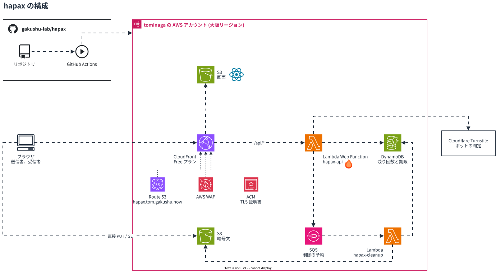

# hapax

一時ファイル共有サービス。アップロードすると期限と回数制限付きの URL が発行され、指定回数のダウンロードが終わると削除される。暗号化はブラウザで行い、サーバーは平文もファイル名も知らない。

https://hapax.tom.gakushu.now/ (未デプロイ)

## 構成

研修環境 gakushu-lab の tominaga アカウント (大阪リージョン) に置く。研修環境には次の制約がある。

| 制約 | hapax での扱い |
|---|---|
| IAM ロールを作れない | Lambda は既存の `LabLambdaExec`、GitHub Actions は既存の `LabGitHubDeploy` を使う |
| 使えるサービスが決まっている | EventBridge Scheduler は実行ロールが要るので使わない。削除の予約は Amazon Simple Queue Service (SQS) で行う |
| 1人 月 3 USD まで | 超えると翌月1日まで AWS の操作とデプロイが止まる。アプリは動いたまま。ファイルの上限を 100MiB にする |

## 予定スタック

| 層 | 採用 |
|---|---|
| 配信 | CloudFront (Free プラン)。画面は S3、`/api/*` は Lambda Web Function |
| API | TypeScript + Hono on Lambda Web Function (Node.js 24) |
| メタデータと回数制御 | DynamoDB (条件付き更新で回数を減らす) |
| ファイル本体 | S3 (署名付き URL でブラウザから直接読み書き)。1ファイル 100MiB まで |
| 削除 | SQS の遅延配信で削除用 Lambda を呼ぶ。遅延は最大15分なので、それより先の予約は削除用 Lambda が送り直してつなぐ。S3 のライフサイクル規則と DynamoDB の有効期限 (Time To Live, TTL) は保険 |
| 画面 | Vite + React の単一ページアプリケーション (Single Page Application, SPA)。デジタル庁デザインシステムのトークンと React 版サンプル部品。ライトとダークは OS の設定に従う。アイコンは Phosphor |
| 暗号化 | ブラウザ側で Advanced Encryption Standard Galois/Counter Mode (AES-GCM) 256bit、64KiB ごとのチャンク暗号化 (WebCrypto) |
| 不正利用対策 | Turnstile、AWS WAF (Free プランに含まれる。IP アドレス単位のレート制限) |
| Infrastructure as Code (IaC) | Terraform。Lambda Web Function は Terraform が未対応なので `aws lambda-web deploy` で配置する |
| ローカル開発 | DynamoDB Local と S3Mock (docker compose) |
| CI/CD | GitHub Actions。OpenID Connect (OIDC) で `LabGitHubDeploy` を引き受ける。長期のアクセスキーは使わない |
| 運用指標 | CloudWatch (埋め込みメトリクス形式とダッシュボード) |

## 機能予定

- ファイル本体は API を通さない。ブラウザが暗号化し、`POST /api/uploads` で受け取った S3 の署名付き PUT URL へ直接送る
- 発行 URL: `https://hapax.tom.gakushu.now/d/{id}#{key}`。鍵は fragment にあり、サーバーに送られない
- ダウンロード: `POST /api/downloads/{id}/consume` で DynamoDB の残り回数を減らし、署名付き GET URL を返す。ブラウザで復号する
- 回数が0になったら、署名付き URL の期限が切れた後に SQS の予約で S3 から削除する
- パスワード追加オプション (Password-Based Key Derivation Function 2 (PBKDF2) で fragment の鍵を包む)
- 期限切れも同じ予約で削除し、S3 のライフサイクル規則 (8日) で取りこぼしを消す

## 開発ステータス

[open issues](https://github.com/gakushu-lab/hapax/issues) を参照。作業順は #1 の冒頭に書いてある。
